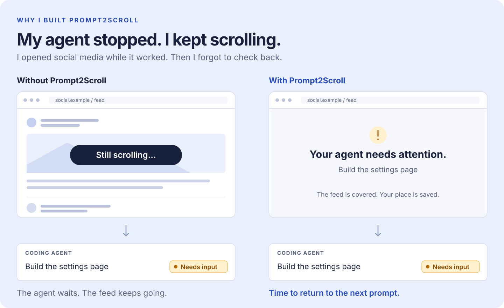
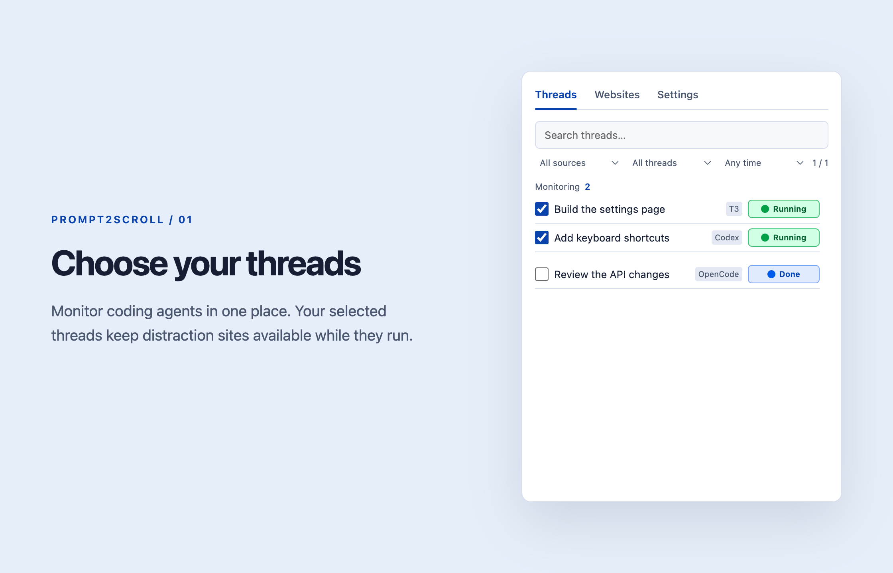
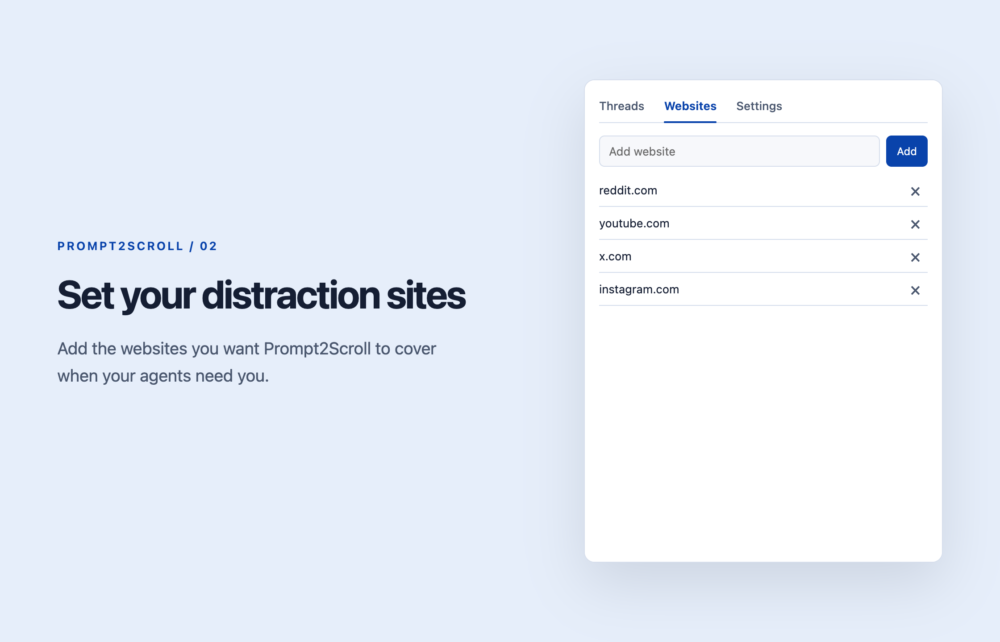
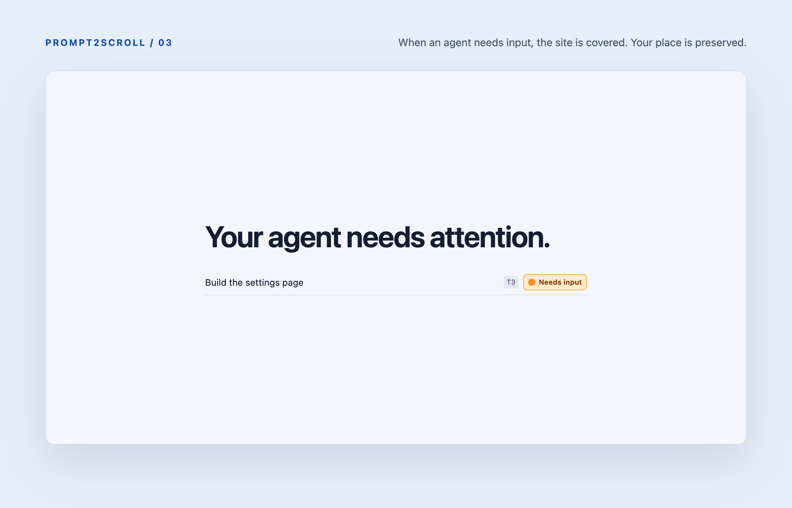

# Prompt2Scroll

Scroll while your coding agents work. When they need you, Prompt2Scroll covers the page so you can get back to your next prompt, without losing your place.

I built this because I'd open social media while my agent was working, then forget to check back. The agent would finish or need input, and I'd still be scrolling. Work had stopped, but I hadn't. I wanted something that would interrupt the scrolling when it was time to prompt again.



Everything runs locally. No account or cloud service.

## See it in action

Select the threads you want to watch, then browse while they run.



Choose which websites should be covered when your agents need attention.



When a selected agent needs input or finishes, Prompt2Scroll covers the page so you can return to your work without losing your place.



<sub>Screenshots use sample threads in the current interface.</sub>

## Install

Requires desktop Firefox 142+ and [Node.js 22.13+](https://nodejs.org/). Supports macOS and Linux.

1. Download the preview ZIP from [Releases](https://github.com/teunvanderploeg/Prompt2Scroll/releases) and unzip it.
2. **macOS:** double-click `Install.command`. Or open a terminal in the folder and run `sh install.sh` on either system.
3. In Firefox, open `about:debugging#/runtime/this-firefox`, click **Load Temporary Add-on**, and choose `~/.prompt2scroll/extension/manifest.json`.
4. Open Prompt2Scroll in the toolbar and select your threads. Manage sites under **Websites**.

This is an unsigned preview. Load it again after Firefox restarts. Signed releases use Firefox's **Install Add-on From File** menu instead and stay installed. [Preparing a signed release](docs/releasing.md).

The installer keeps the app in `~/.prompt2scroll`. You can delete the downloaded folder afterward. No administrator access or background service is needed. Linux needs `lsof` for T3 detection.

## Connect your agents

T3 Code v2 and OpenCode v2 appear automatically. For OpenCode, install with its `opencode` command on your PATH.

Start Codex CLI through the installed launcher:

```sh
~/.prompt2scroll/codex -C /path/to/project
```

It accepts normal Codex arguments, including `resume`. Codex must support `--remote` and `app-server --listen stdio://`. Sessions started with plain `codex` are not monitored.

All selected threads must be running to unlock sites. Removing the last watched thread unblocks sites and returns blocked tabs to their original pages. Enable **Any running agent** in Settings to unlock when any detected agent runs. Settings also has dark mode and the countdown duration. Enable **Auto-open finished threads** to switch to a monitored T3 Code thread when it finishes or needs attention. In Any running agent mode, this applies to all T3 Code threads. This setting is off by default. Changes save automatically.

## Troubleshooting

Run `~/.prompt2scroll/inspect` for connection details. Rerun the installer after changing your Node installation or agent PATH. To update, run the new installer and reload or update the Firefox extension. Saved extension settings stay in Firefox.

## Develop

Use Node.js 24+ for the full test suite. The installed companion also supports Node.js 22.13+.

```sh
npm ci
npm run setup
npm run check
npm test
npm run lint:extension
```

`npm run release` makes a shareable preview ZIP. [Architecture and detection](docs/technical.md) · [Release and signing](docs/releasing.md)

## Mozilla reviewers

See [reviewer build instructions](docs/reviewer/README.md) for the exact tool versions, installation steps and reproducible build command: `sh scripts/reviewer-build.sh`.
